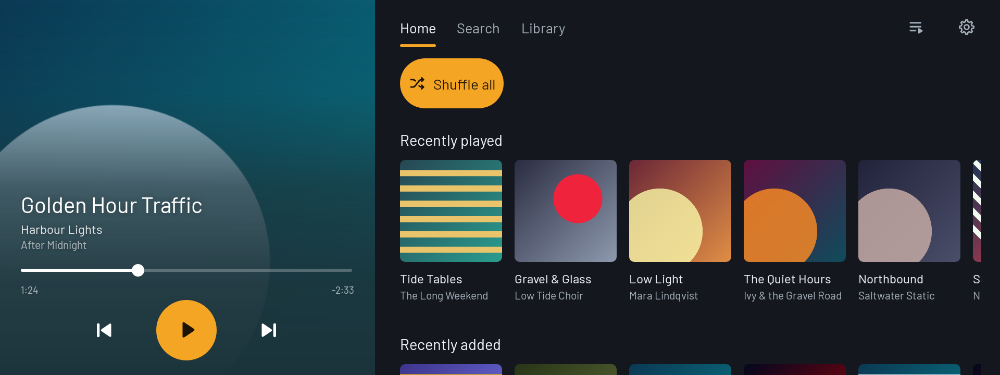
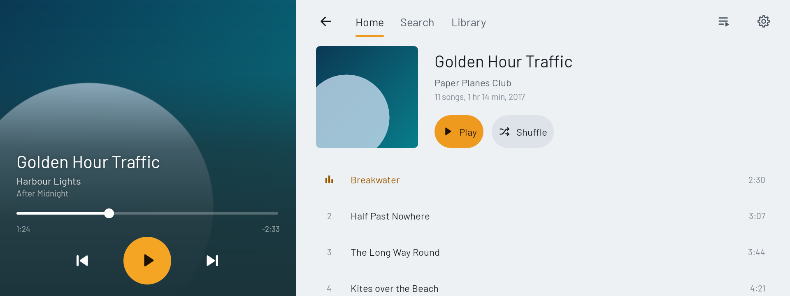
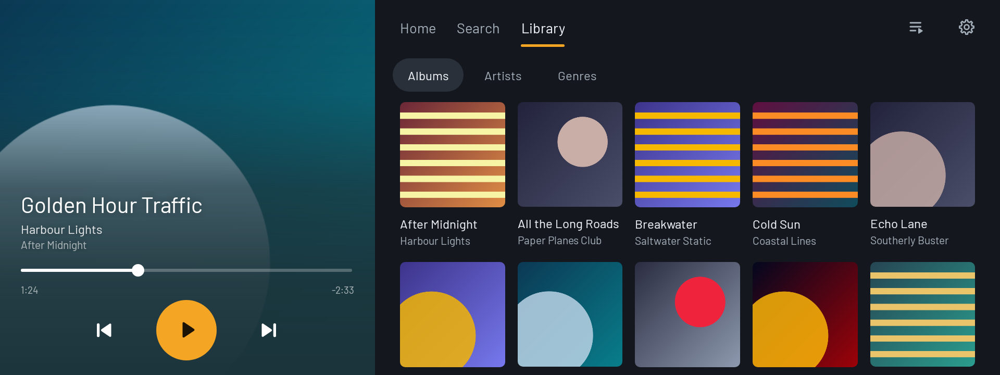
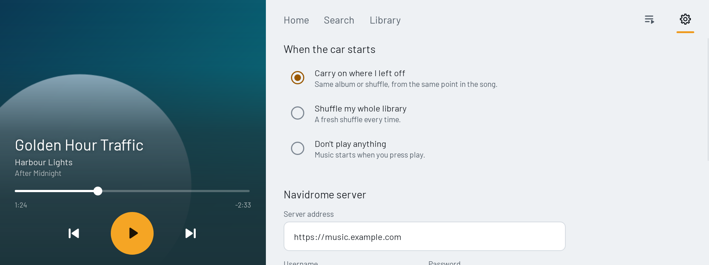

## CarMediaPlayer
A replacement for the stock media player in my MG4 Excite 51, for streaming from a Navidrome (Subsonic) server.

Installs over the stock media player and maintains the correct requirements for the launcher and system to still interact with it.

Written with Claude Code. Credit to lkernan for the initial idea.

Tested on an Australian 2025 MG4 Excite 51 with firmware 1100 SWI131 R27 09.08.24.

Other models, regions or firmware versions may not work.

## Features

- Stream from any Subsonic server.
- Scrobbles plays, and saves them to send later when there's no signal.
- Works with the stock launcher and all steering wheel controls.
- Autoplay when the car starts: resume where you left off, shuffle your library, or stay quiet.
- Pre-caches the next 10 songs and their covers.
- Browse albums, artists and genres, plus search as you type.
- Day and night themes that follow the car's theme.
- One-tap updates from Settings.

To uninstall, remove the app update.

